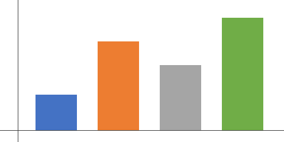

# 2026년 4분기 업무 보고서

작성 부서: **기획팀** · 작성일: 2026. 11. 21.

## 1. 개요

이 문서는 *Markdown* 으로 작성한 뒤 `md2hwpx` 로 변환한 **한글(HWPX) 문서** 예시입니다.
줄을 바꿔 적어도 같은 문단으로 이어지고,
줄 끝에 공백 두 칸을 두면  
이렇게 강제로 줄이 바뀝니다.

글자 서식: **굵게**, *기울임*, ***굵게 기울임***, ~~취소선~~, <u>밑줄</u>, ==형광펜==,
H<sub>2</sub>O, x<sup>2</sup>, [링크](https://www.hancom.com).

## 2. 주요 성과

- 신규 고객 **120곳** 확보
- 처리 시간 단축
  - 접수 단계: 3일 → 1일
  - 검토 단계: 5일 → 2일
- 만족도 조사 실시

1. 1단계: 현황 분석
2. 2단계: 개선안 마련
3. 3단계: 시범 적용

- [x] 예산 확정
- [ ] 인력 충원

## 3. 실적 표

| 구분 | 목표 | 실적 | 달성률 |
|:-----|-----:|-----:|:------:|
| 매출 | 1,000 | 1,120 | 112% |
| 신규 고객 | 100 | 120 | 120% |
| 비용 절감 | 50 | 42 | 84% |

## 4. 분기별 추이

{width=70%}

> 참고: 위 수치는 잠정치이며, 확정치는 12월 중 다시 보고합니다.
> 문의는 기획팀으로 해 주세요.

---

### 부록: 자동화 스크립트

```python
from hwpxwriter import markdown_to_hwpx

markdown_to_hwpx(open("보고서.md").read(), "보고서.hwpx", page_number=True)
```

\newpage

## 5. 향후 계획

다음 분기에는 시범 적용 결과를 바탕으로 전 부서에 확대합니다.
