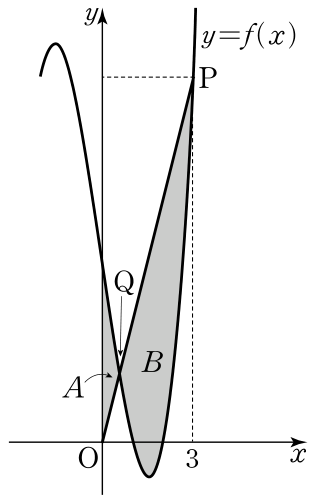
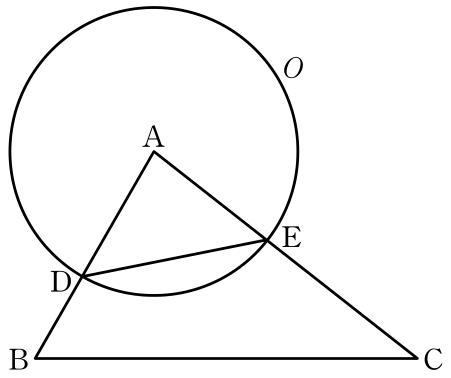
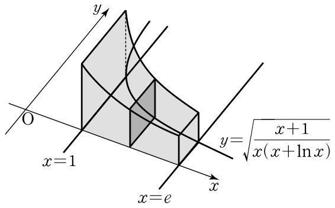

::: 시험지
위: 2025학년도 대학수학능력시험 문제지
교시: 제 2 교시
영역: 수학 영역
유형: 홀수형
:::

::: 문제
$\sqrt[3]{5}\times 25^{\frac{1}{3}}$의 값은? [2점]

① 1 ② 2 ③ 3 ④ 4 ⑤ 5
[정답] ⑤
:::

::: 문제
함수 $f(x)=x^3-8x+7$에 대하여 $\displaystyle\lim_{h\to 0}\frac{f(2+h)-f(2)}{h}$의 값은? [2점]

① 1 ② 2 ③ 3 ④ 4 ⑤ 5
[정답] ④
:::

::: 문제
첫째항과 공비가 모두 양수 $k$인 등비수열 $\{a_n\}$이

$$\frac{a_4}{a_2}+\frac{a_2}{a_1}=30$$

을 만족시킬 때, $k$의 값은? [3점]

① 1 ② 2 ③ 3 ④ 4 ⑤ 5
[정답] ⑤
:::

::: 문제
함수

$$f(x)=\begin{cases}5x+a & (x<-2)\\ x^2-a & (x\ge -2)\end{cases}$$

가 실수 전체의 집합에서 연속일 때, 상수 $a$의 값은? [3점]

① 6 ② 7 ③ 8 ④ 9 ⑤ 10
[정답] ②
:::

::: 문제
함수 $f(x)=(x^2+1)(3x^2-x)$에 대하여 $f'(1)$의 값은? [3점]

① 8 ② 10 ③ 12 ④ 14 ⑤ 16
[정답] ④
:::

::: 문제
$\cos\left(\dfrac{\pi}{2}+\theta\right)=-\dfrac{1}{5}$일 때, $\dfrac{\sin\theta}{1-\cos^2\theta}$의 값은? [3점]

① $-5$ ② $-\sqrt{5}$ ③ $0$ ④ $\sqrt{5}$ ⑤ $5$
[정답] ⑤
:::

::: 문제
다항함수 $f(x)$가 모든 실수 $x$에 대하여

$$\int_0^x f(t)\,dt=3x^3+2x$$

를 만족시킬 때, $f(1)$의 값은? [3점]

① 7 ② 9 ③ 11 ④ 13 ⑤ 15
[정답] ③
:::

::: 문제
두 실수 $a=2\log\dfrac{1}{\sqrt{10}}+\log_2 20$, $b=\log 2$에 대하여 $a\times b$의 값은? [3점]

① 1 ② 2 ③ 3 ④ 4 ⑤ 5
[정답] ①
:::

::: 문제
함수 $f(x)=3x^2-16x-20$에 대하여

$$\int_{-2}^{a} f(x)\,dx=\int_{-2}^{0} f(x)\,dx$$

일 때, 양수 $a$의 값은? [4점]

① 16 ② 14 ③ 12 ④ 10 ⑤ 8
[정답] ④
:::

::: 문제
닫힌구간 $[0,\,2\pi]$에서 정의된 함수 $f(x)=a\cos bx+3$이 $x=\dfrac{\pi}{3}$에서 최댓값 13을 갖도록 하는 두 자연수 $a$, $b$의 순서쌍 $(a,\,b)$에 대하여 $a+b$의 최솟값은? [4점]

① 12 ② 14 ③ 16 ④ 18 ⑤ 20
[정답] ③
:::

::: 문제
시각 $t=0$일 때 출발하여 수직선 위를 움직이는 점 P의 시각 $t\ (t\ge 0)$에서의 위치 $x$가

$$x=t^3-\frac{3}{2}t^2-6t$$

이다. 출발한 후 점 P의 운동 방향이 바뀌는 시각에서의 점 P의 가속도는? [4점]

① 6 ② 9 ③ 12 ④ 15 ⑤ 18
[정답] ②
:::

::: 문제
$a_1=2$인 수열 $\{a_n\}$과 $b_1=2$인 등차수열 $\{b_n\}$이 모든 자연수 $n$에 대하여

$$\sum_{k=1}^{n}\frac{a_k}{b_{k+1}}=\frac{1}{2}n^2$$

을 만족시킬 때, $\displaystyle\sum_{k=1}^{5}a_k$의 값은? [4점]

① 120 ② 125 ③ 130 ④ 135 ⑤ 140
[정답] ①
:::

::: 문제
최고차항의 계수가 1인 삼차함수 $f(x)$가

$$f(1)=f(2)=0,\quad f'(0)=-7$$

을 만족시킨다. 원점 O와 점 $\mathrm{P}(3,\,f(3))$에 대하여 선분 OP가 곡선 $y=f(x)$와 만나는 점 중 P가 아닌 점을 Q라 하자. 곡선 $y=f(x)$와 $y$축 및 선분 OQ로 둘러싸인 부분의 넓이를 $A$, 곡선 $y=f(x)$와 선분 PQ로 둘러싸인 부분의 넓이를 $B$라 할 때, $B-A$의 값은? [4점]

{width=60%}

① $\dfrac{37}{4}$ ② $\dfrac{39}{4}$ ③ $\dfrac{41}{4}$ ④ $\dfrac{43}{4}$ ⑤ $\dfrac{45}{4}$
[정답] ⑤
:::

::: 문제
그림과 같이 삼각형 ABC에서 선분 AB 위에 $\overline{\mathrm{AD}}:\overline{\mathrm{DB}}=3:2$인 점 D를 잡고, 점 A를 중심으로 하고 점 D를 지나는 원을 $O$, 원 $O$와 선분 AC가 만나는 점을 E라 하자.

$\sin A:\sin C=8:5$이고, 삼각형 ADE와 삼각형 ABC의 넓이의 비가 $9:35$이다. 삼각형 ABC의 외접원의 반지름의 길이가 7일 때, 원 $O$ 위의 점 P에 대하여 삼각형 PBC의 넓이의 최댓값은? (단, $\overline{\mathrm{AB}}<\overline{\mathrm{AC}}$) [4점]

{width=60%}

① $18+15\sqrt{3}$ ② $24+20\sqrt{3}$ ③ $30+25\sqrt{3}$ ④ $36+30\sqrt{3}$ ⑤ $42+35\sqrt{3}$
[정답] ④
:::

::: 문제
상수 $a\ (a\ne 3\sqrt{5})$와 최고차항의 계수가 음수인 이차함수 $f(x)$에 대하여 함수

$$g(x)=\begin{cases}x^3+ax^2+15x+7 & (x\le 0)\\ f(x) & (x>0)\end{cases}$$

이 다음 조건을 만족시킨다.

> (가) 함수 $g(x)$는 실수 전체의 집합에서 미분가능하다.
>
> (나) $x$에 대한 방정식 $g'(x)\times g'(x-4)=0$의 서로 다른 실근의 개수는 4이다.

$g(-2)+g(2)$의 값은? [4점]

① 30 ② 32 ③ 34 ④ 36 ⑤ 38
[정답] ②
:::

::: 문제
방정식

$$\log_2(x-3)=\log_4(3x-5)$$

를 만족시키는 실수 $x$의 값을 구하시오. [3점]
[정답] 7
:::

::: 문제
다항함수 $f(x)$에 대하여 $f'(x)=9x^2+4x$이고 $f(1)=6$일 때, $f(2)$의 값을 구하시오. [3점]
[정답] 33
:::

::: 문제
수열 $\{a_n\}$이 모든 자연수 $n$에 대하여

$$a_n+a_{n+4}=12$$

를 만족시킬 때, $\displaystyle\sum_{n=1}^{16}a_n$의 값을 구하시오. [3점]
[정답] 96
:::

::: 문제
양수 $a$에 대하여 함수 $f(x)$를

$$f(x)=2x^3-3ax^2-12a^2x$$

라 하자. 함수 $f(x)$의 극댓값이 $\dfrac{7}{27}$일 때, $f(3)$의 값을 구하시오. [3점]
[정답] 41
:::

::: 문제
곡선 $y=\left(\dfrac{1}{5}\right)^{x-3}$과 직선 $y=x$가 만나는 점의 $x$좌표를 $k$라 하자. 실수 전체의 집합에서 정의된 함수 $f(x)$가 다음 조건을 만족시킨다.

> $x>k$인 모든 실수 $x$에 대하여
>
> $f(x)=\left(\dfrac{1}{5}\right)^{x-3}$이고 $f(f(x))=3x$이다.

$f\left(\dfrac{1}{k^3\times 5^{3k}}\right)$의 값을 구하시오. [4점]
[정답] 36
:::

::: 문제
함수 $f(x)=x^3+ax^2+bx+4$가 다음 조건을 만족시키도록 하는 두 정수 $a$, $b$에 대하여 $f(1)$의 최댓값을 구하시오. [4점]

> 모든 실수 $\alpha$에 대하여 $\displaystyle\lim_{x\to\alpha}\frac{f(2x+1)}{f(x)}$의 값이 존재한다.
[정답] 16
:::

::: 문제
모든 항이 정수이고 다음 조건을 만족시키는 모든 수열 $\{a_n\}$에 대하여 $|a_1|$의 값의 합을 구하시오. [4점]

> (가) 모든 자연수 $n$에 대하여
>
> $$a_{n+1}=\begin{cases}a_n-3 & (|a_n|\text{이 홀수인 경우})\\ \dfrac{1}{2}a_n & (a_n=0\text{ 또는 }|a_n|\text{이 짝수인 경우})\end{cases}$$
>
> 이다.
>
> (나) $|a_m|=|a_{m+2}|$인 자연수 $m$의 최솟값은 3이다.
[정답] 64
:::

\선택과목 미적분

::: 문제
$\displaystyle\lim_{x\to 0}\frac{3x^2}{\sin^2 x}$의 값은? [2점]

① 1 ② 2 ③ 3 ④ 4 ⑤ 5
[정답] ③
:::

::: 문제
$\displaystyle\int_0^{10}\frac{x+2}{x+1}\,dx$의 값은? [3점]

① $10+\ln 5$ ② $10+\ln 7$ ③ $10+2\ln 3$ ④ $10+\ln 11$ ⑤ $10+\ln 13$
[정답] ④
:::

::: 문제
수열 $\{a_n\}$에 대하여 $\displaystyle\lim_{n\to\infty}\frac{na_n}{n^2+3}=1$일 때, $\displaystyle\lim_{n\to\infty}\left(\sqrt{a_n^{\,2}+n}-a_n\right)$의 값은? [3점]

① $\dfrac{1}{3}$ ② $\dfrac{1}{2}$ ③ $1$ ④ $2$ ⑤ $3$
[정답] ②
:::

::: 문제
그림과 같이 곡선 $y=\sqrt{\dfrac{x+1}{x(x+\ln x)}}$과 $x$축 및 두 직선 $x=1$, $x=e$로 둘러싸인 부분을 밑면으로 하는 입체도형이 있다. 이 입체도형을 $x$축에 수직인 평면으로 자른 단면이 모두 정사각형일 때, 이 입체도형의 부피는? [3점]

{width=60%}

① $\ln(e+1)$ ② $\ln(e+2)$ ③ $\ln(e+3)$ ④ $\ln(2e+1)$ ⑤ $\ln(2e+2)$
[정답] ①
:::

::: 문제
최고차항의 계수가 1인 삼차함수 $f(x)$에 대하여 함수 $g(x)$를

$$g(x)=f(e^x)+e^x$$

이라 하자. 곡선 $y=g(x)$ 위의 점 $(0,\,g(0))$에서의 접선이 $x$축이고 함수 $g(x)$가 역함수 $h(x)$를 가질 때, $h'(8)$의 값은? [3점]

① $\dfrac{1}{36}$ ② $\dfrac{1}{18}$ ③ $\dfrac{1}{12}$ ④ $\dfrac{1}{9}$ ⑤ $\dfrac{5}{36}$
[정답] ①
:::

::: 문제
실수 전체의 집합에서 미분가능한 함수 $f(x)$의 도함수 $f'(x)$가

$$f'(x)=-x+e^{1-x^2}$$

이다. 양수 $t$에 대하여 곡선 $y=f(x)$ 위의 점 $(t,\,f(t))$에서의 접선과 곡선 $y=f(x)$ 및 $y$축으로 둘러싸인 부분의 넓이를 $g(t)$라 하자. $g(1)+g'(1)$의 값은? [4점]

① $\dfrac{1}{2}e+\dfrac{1}{2}$ ② $\dfrac{1}{2}e+\dfrac{2}{3}$ ③ $\dfrac{1}{2}e+\dfrac{5}{6}$ ④ $\dfrac{2}{3}e+\dfrac{1}{2}$ ⑤ $\dfrac{2}{3}e+\dfrac{2}{3}$
[정답] ②
:::

::: 문제
등비수열 $\{a_n\}$이

$$\sum_{n=1}^{\infty}\left(|a_n|+a_n\right)=\frac{40}{3},\quad \sum_{n=1}^{\infty}\left(|a_n|-a_n\right)=\frac{20}{3}$$

을 만족시킨다. 부등식

$$\lim_{n\to\infty}\sum_{k=1}^{2n}\left((-1)^{\frac{k(k+1)}{2}}\times a_{m+k}\right)>\frac{1}{700}$$

을 만족시키는 모든 자연수 $m$의 값의 합을 구하시오. [4점]
[정답] 25
:::

::: 문제
두 상수 $a\ (1\le a\le 2)$, $b$에 대하여 함수 $f(x)=\sin(ax+b+\sin x)$가 다음 조건을 만족시킨다.

> (가) $f(0)=0$, $f(2\pi)=2\pi a+b$
>
> (나) $f'(0)=f'(t)$인 양수 $t$의 최솟값은 $4\pi$이다.

함수 $f(x)$가 $x=\alpha$에서 극대인 $\alpha$의 값 중 열린구간 $(0,\,4\pi)$에 속하는 모든 값의 집합을 $A$라 하자. 집합 $A$의 원소의 개수를 $n$, 집합 $A$의 원소 중 가장 작은 값을 $\alpha_1$이라 하면, $n\alpha_1-ab=\dfrac{q}{p}\pi$이다. $p+q$의 값을 구하시오. (단, $p$와 $q$는 서로소인 자연수이다.) [4점]
[정답] 17
:::
